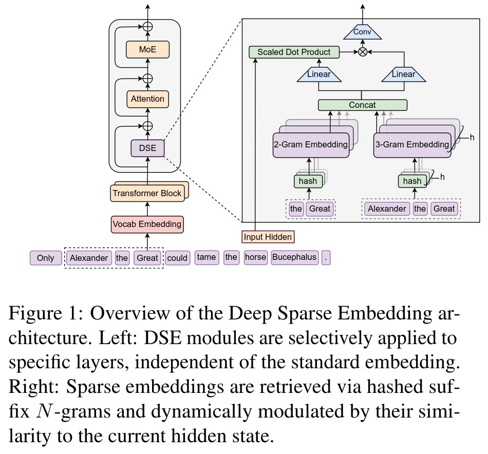

论文：<https://aclanthology.org/2026.acl-long.226.pdf>

本人不是 AI 方向，本文基于个人理解，不保真。

MOE: 每次只算一小部分参数。

Conditional memory: 每次只查一小部分参数。

这篇论文给 Transformer 加了一个哈希表组件（DSE，Deep Sparse Embedding）。假如当前是第 t 个 token, $\text{token}_t$。2-gram 就是 $[\text{token}_{t-1}, \text{token}_t]$，3-gram 就是 $[\text{token}_{t-2}, \text{token}_{t-1}, \text{token}_t]$。把 2-gram 和 3-gram 拿出来哈希，分别从各自的哈希表里查出向量，拼起来，再用当前层的 hidden state 做门控过滤，加到残差流上。

哈希表的 value 跟 token 的 embedding 类似，最开始是随机初始化的，根据反向传播训练。训练过程会自动把这些参数调成能减少 loss 的状态。相当于是把 2-gram 和 3-gram 在整个训练语料中的含义存下来了。

相当于是把记忆相关的参数 offload 到了哈希表里，稀疏查询。这样模型可以把层数和注意力省下来做推理。

查表的地址只依赖固定的 token ID，所以可以把整张表扔到 CPU 内存里预取。

n-gram 建在压缩后的 token ID 上，做了转小写等。Apple 和 apple 在算 n-gram 的时候会被映射成同一个压缩 ID，因此是等价的。应该是为了让对同一个事物的记忆尽量存到一起。压缩后的 token ID 只在 DSE 里用。外层的词表仍然是无损的词表。

因为哈希表槽位有限，所以一个槽实际上是被上千个 n-gram 共享的。为了从这些共享记忆里取出真正匹配的记忆，做了多头哈希，每个 n-gram 都用 K 个不同的哈希函数哈希，对应 K 个哈希表。一个 token 有 2-gram 和 3-gram，所以对应 2K 张表（K=8，一共 16 张）。从这些表里取出向量之后拼在一起，得到 1280 维的 $e_t$（模型的 hidden 是 2560，中间还要过一层投影）。用 hidden state 做门控粗筛一下，如果是明显不相关的记忆就丢掉，说明这个 2/3-gram 不在表里。如果有相关就把向量注入到残差流，由神经网络从这些混杂了不相关记忆的参数里取出需要的记忆。
